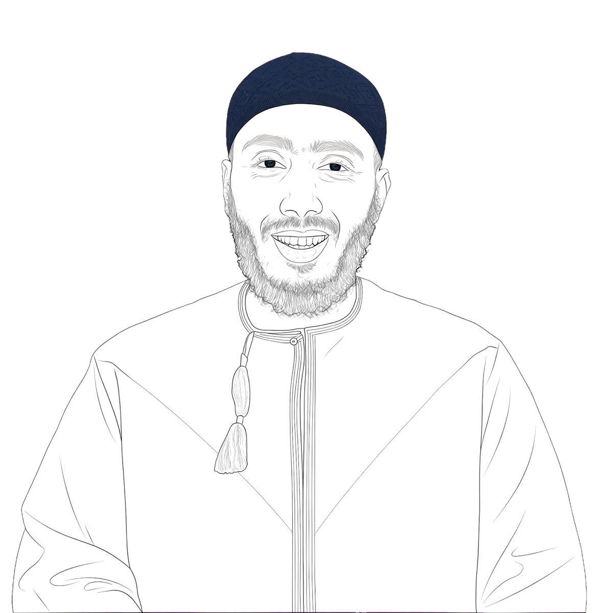

# Hi, I'm Mohamed Negm 👋

Founder and owner of **Nujoom Digital LLC**, a full stack software engineer. I build web and iOS apps, and tools that make everyday tasks simpler.

Before software, I spent 10 years teaching math, science and technology in NYC and WA public schools, and I hold an MA in STEM Education.

  

<a href="https://moenegm.github.io/moenegm/">Visit my portfolio website ↗</a>

## What I'm working on

| Project | What it is | Built with |
|---|---|---|
| [Nujoom Digital](https://github.com/moenegm/nujoom_digital) | Company website with online booking, contact and a private client intake flow | Ruby on Rails, Kamal |
| [Kalimati](https://github.com/moenegm/Kalimati) | iOS app that helps kids learn Arabic | Swift, Xcode |
| [Tasbih Studio](https://github.com/moenegm/TasbihCounter) | iOS tasbih (dhikr) counter | Swift, Xcode |
| [Backup Drive Organizer Pro](https://github.com/moenegm/backup-drive-organizer-pro) | Mac app that turns a messy backup drive into a clean, organized copy by place and date, with duplicate cleanup | Python, PyQt6 |

## Tools I use

Ruby on Rails · Swift · Python · JavaScript / TypeScript · React · PostgreSQL · MySQL

## Get in touch

- [NujoomDigital.com](https://nujoomdigital.com)
